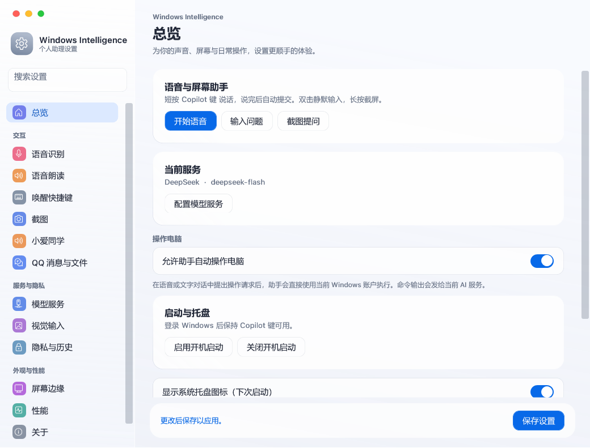

# Windows Intelligence

Windows 11 桌面 AI 助手，通过 Copilot 键或自定义快捷键打开。它在本机识别语音，可以把语音转写、文字或截图交给你选择的模型回答，也可按明确指令用 PowerShell 操作电脑。回复以 Markdown 显示，可用本地 Kokoro、MiniMax 或 ElevenLabs 朗读。

[下载安装包](https://github.com/admin7730/windows-intelligence/releases/latest) · [获取 API 密钥](#获取-api-密钥) · [技术架构](#技术架构) · [未来展望](#未来展望)

## 0.2.45 更新



- **玻璃设置界面**：macOS 风格浅色侧栏、彩色图标、红黄绿窗口按钮、圆角分组和悬浮保存栏；新增设置搜索。减少动画时即时切换，背景使用 Windows DWM 合成。
- **看得见的电脑操作**：显示每一步说明、实际 PowerShell 命令、输出、错误、退出码和用时，保留取消操作。
- **首段语音同步结果**：开启朗读时，第一段可播放音频生成后显示最终文字与工具结果；后续音频继续生成、依次播放。静默时立即显示文字。回答优先给出准确结论。
- **语音资源管理**：保留实时识别，语音键触发后后台加载准确模型，结束后空闲约 30 秒释放重模型。语音球已移除。
- **实验性小爱与 QQ 接入**：新增官方技能桥接和只读 QQ 通知/下载目录检测，默认关闭。真实平台与音箱尚未联调，需要自行配置 HTTPS 服务和授权；不宣称全局原生对话自动接管或完整 QQ 聊天记录访问。[接入说明](integrations/xiaoai/README.md)

[更新说明](docs/UPDATE_0.2.45.md) · [验证范围](docs/testing-report.md)

## 安装与初次配置

1. 在[发布页](https://github.com/admin7730/windows-intelligence/releases/latest)的 **Assets（资源）** 下下载 `WindowsIntelligence-<版本>-x64.zip`。适用于 Windows 11 22H2 或更新版本的 x64 设备。
2. 右键 ZIP，选择 **全部解压缩**。打开解压后的文件夹，确认 `Install-MSIX.cmd`、`Install-MSIX.ps1`、`WindowsIntelligence.msix` 和 `WindowsIntelligence-Signing.cer` 在同一目录，再双击 `Install-MSIX.cmd`。首次安装需要管理员批准。脚本会核对 MSIX 与公开证书，将证书加入「本地计算机 → 受信任的人」，并为当前用户安装应用。
3. 从开始菜单启动 **Windows Intelligence**，双击任务栏通知区域的图标打开设置。在「模型服务」填入 API Key，再点「保存设置」。
4. 在「唤醒快捷键」打开 Windows 按键选择器，再选择 Windows Intelligence。也可在应用内录制其他全局快捷键。

> GitHub 的 **Code → Download ZIP** 和 **Source code (zip)** 提供源码。请先构建源码，或从发布页的 **Assets（资源）** 下载可直接安装的 ZIP。

## 使用

| 操作 | 行为 |
| --- | --- |
| 短按唤醒键 | 开始语音识别，说完后自动提交最终转写 |
| 双击唤醒键 | 打开静默文字输入，以文字显示回复 |
| 长按唤醒键 | 截图提问，可在发送前预览、裁剪和遮挡 |
| Esc | 关闭助手 |
| 托盘菜单 | 开始语音、输入问题、截图提问、打开设置或退出 |

例如，可以说“查询 C 盘剩余空间”或“打开记事本”。模型支持工具调用且「总览 → 允许助手自动操作电脑」已启用时，助手可以用当前 Windows 用户的权限运行 PowerShell。命令输出会作为上下文发送给当前模型服务。

## 获取 API 密钥

安装包中的语音识别模型可离线使用。使用本地 Kokoro 朗读也无需 API Key。云端问答和云端朗读分别使用各自服务的密钥。

| 服务 | 如何获取 | 在应用中配置 |
| --- | --- | --- |
| **DeepSeek** · 默认问答 | 登录开放平台，打开 **API Keys** 并创建密钥。[创建密钥](https://platform.deepseek.com/api_keys) · [官方指南](https://api-docs.deepseek.com/zh-cn/) | 在「模型服务」选择 **DeepSeek**，保存 API Key。默认 API 基础地址为 `https://api.deepseek.com`，文本和视觉模型字段默认填写 `deepseek-flash`。 |
| **MiniMax** · 默认云端朗读 | 登录开放平台，在 **接口密钥** 创建用于按量语音合成的 API Key。[创建密钥](https://platform.minimax.cn/console/keys) · [官方指南](https://platform.minimax.cn/docs/guides/quickstart-preparation) | 在「语音朗读」选择 **MiniMax（HD → Turbo）**，填入密钥，再点「保存并试听」。应用优先用 Speech-2.8-HD，失败时自动尝试 Speech-2.8-Turbo。 |
| **ElevenLabs** · 可选云端朗读 | 登录后打开 **Developers → API Keys** 并创建密钥。若限制密钥权限，请启用 **Text to Speech**。[创建密钥](https://elevenlabs.io/app/api/api-keys) · [官方指南](https://elevenlabs.io/docs/help-center/technical/how-do-i-authorize-myself-using-an-api-key) | 在「语音朗读」选择 **ElevenLabs**，填入密钥，保留预设模型和 Voice ID，或改成账号可用的音色，再点「保存并试听」。 |

也可以在「模型服务」添加支持 Chat Completions 的其他服务，填写该服务的 API **基础地址**、密钥和模型 ID。截图问答需要支持图像输入的模型，并在「视觉输入」勾选「所选视觉模型支持图像」。

API 用量和额度由各服务商管理。应用通过 Windows 凭据管理器保存 API Key。请在应用设置中输入密钥，避免把密钥贴到 GitHub Issue、日志或截图里。

## 技术架构

| 模块 | 实现 |
| --- | --- |
| Windows 桌面层 | .NET 10 与 WPF 提供输入框、托盘和设置。MSIX 注册 Copilot 键扩展及激活协议，命名管道把激活传给同一用户、会话和应用身份下的已运行进程。 |
| 本地语音识别 | NAudio 采集麦克风音频，sherpa-onnx 与 ONNX Runtime 在本机运行模型。Zipformer 负责实时预览，Qwen3-ASR 负责准确模式下的整句转写，SenseVoice 用于快速模式或回退。Silero VAD 辅助判断语音段。 |
| 模型与工具调用 | Chat Completions 客户端处理文本、截图、流式回复和工具调用。PowerShell 执行器把本机命令的退出码、输出和错误返回给模型。 |
| 截图与动效 | 原生 C++ 模块 `WinNative.dll` 调用 Windows Graphics Capture，用 Direct3D 11 和 HLSL 生成屏幕边缘光，由分层 Win32 窗口呈现。应用截图时短暂隐藏自身窗口，截图完成后恢复。 |
| 朗读与部署 | 本地 Kokoro 和云端朗读共用应用内的音频播放。自包含的签名 MSIX 随附语音模型和所需的 .NET 运行时。 |

[架构图、数据流与源码入口](docs/architecture.md) · [第三方软件及模型说明](docs/third-party.md)

## 隐私与本机操作

- 麦克风音频在本机转写。提交后，问题文字和所用的对话上下文会发送给你配置的问答服务。选择云端朗读时，待朗读的文本也会发送给对应服务。
- 截图可在本机预览与编辑。自动发送截图需要在「隐私与历史」授权到当前服务。文本历史可关闭或清除，图片上下文默认关闭。
- PowerShell 可以在当前 Windows 用户权限内访问文件和系统。可在「总览」关闭自动操作。涉及本机操作时，命令输出可能包含文件内容和系统信息，并作为模型上下文发送。

## 未来展望

- **远程桌面与显示兼容**。扩大对远程协助、多屏和不同 DPI 的测试，增加快捷键、窗口位置和图形渲染的诊断信息。
- **本地语音质量与效率**。扩大普通话、粤语、英语和噪声环境下的评测，优化说完到提交的等待时间及空闲资源占用。
- **模型接入与离线使用**。改进服务配置和错误提示，加强对图片、流式输出及工具调用的能力检测，探索与本地对话模型的接入。
- **本机操作的可控性**。已有可见命令与返回结果；继续探索对文件写入等操作提供可配置的确认和工作目录限制。
- **安装与更新体验**。增加独立 Windows 环境下的安装和升级测试，探索按需下载语音模型，缩小首次下载体积。

## 从源码构建

需要 .NET 10 SDK、Visual Studio 2022 C++ x64 Build Tools 和 Windows SDK。构建额外的 Setup EXE 还需要 Inno Setup 6。

```powershell
.\scripts\Get-Models.ps1 -Fixtures
.\scripts\Test.ps1
.\scripts\Build.ps1 -SkipSetup
```

以上命令从仓库根目录运行。MSIX 与完整 ZIP 位于 `artifacts/release/`。在安装调试包之前，需要在测试电脑上信任该构建所使用的签名证书。
