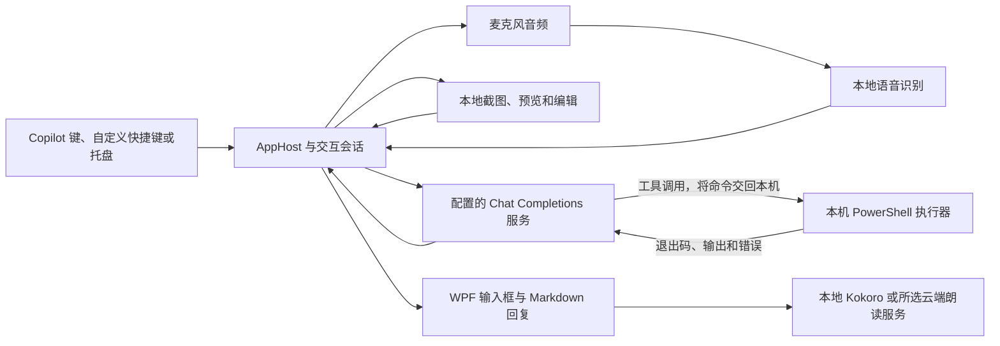

# Windows Intelligence 技术架构

Windows Intelligence 是一个 Windows 11 x64 桌面进程。它用 WPF 承载交互，用原生 C++ 获得桌面截图和绘制屏幕边缘光。语音识别、屏幕采集、问答和朗读各有自己的数据路径。

[返回项目说明](../README.md) · [API 密钥配置](../README.md#获取-api-密钥) · [第三方软件及模型说明](third-party.md)

## 系统数据流

## 启动与交互

- `Program` 和 `SingleInstance` 根据应用身份、Windows 用户 SID 和登录会话区分实例。托盘、设置和助手共享同一个主进程，后续激活通过受权限控制的命名管道转发。
- `CopilotGate` 区分短按、双击、长按及释放，并对快速消息与协议事件去重。`AssistantHotkey` 管理通过 Windows 注册的自定义全局快捷键。
- `Interaction` 管理每次会话的收音、最终转写、截图、提交、回复和取消。WPF 面板展示状态，Markdig 解析 Markdown 回复，供面板渲染为文档。

## 语音、截图与模型

1. **转写。** NAudio 采集麦克风音频，本地模型以 16 kHz 音频工作。Silero VAD 辅助判断语音段，Zipformer 输出实时预览。最终提交优先采用 Qwen3-ASR 的整句转写，快速模式或回退路径可用 SenseVoice。
2. **截图。** 原生模块使用 Windows Graphics Capture 采集显示器或活动窗口。应用通过 `ScreenshotState` 管理捕获、预览、裁剪、遮挡和提交，捕获时暂时隐藏自己的窗口。截图授权绑定到当前模型服务及目标地址。
3. **请求。** `MultimodalRequestBuilder` 按内容选择文本或视觉模型。`AiClient` 调用兼容 Chat Completions 的端点，必要时携带所选上下文和截图。如果服务支持流式回复，客户端可逐步显示结果。
4. **本机操作。** 文本会话满足模型与设置条件时，客户端可提供 `run_powershell` 工具。`PowerShellRunner` 在当前用户身份下执行命令，支持超时、取消和输出长度限制。输出回传给模型以生成结果或继续下一步。
5. **朗读。** `SpeechOutput` 支持离线 Kokoro、MiniMax、ElevenLabs 与自定义朗读 API。MiniMax 使用 HD 到 Turbo 的回退顺序。静默会话使用文字回复。

## 原生渲染与性能

`Overlay` 为各显示器维护各自的渲染面。C++ 和 HLSL 负责屏幕边缘效果，Direct3D 11 渲染图像，原生模块按区域读取像素并通过分层 Win32 窗口呈现。背景材质使用 Windows.UI.Composition 的宿主背景画刷。无动画时停止调度渲染帧。应用可按负载调整粒子数量，也遵循系统减少动画偏好。

## 配置与部署

- 服务、快捷键和外观设置使用当前用户的本地 JSON。API Key 存入 Windows 凭据管理器。可选文本历史保存在本机，最近图片上下文只在启用时保留于内存。
- 自包含 MSIX 归档含 .NET Windows Desktop 运行时、WPF 应用、原生 DLL 和本地语音模型。安装 ZIP 同时提供签名 MSIX、公开证书、安装脚本和 SHA-256 清单。
- MSIX 清单定义应用身份、协议、Copilot 键扩展及可选的开机启动。公开发布和本地签名构建的应用身份以各自的 Publisher 为准。

## 源码入口

| 路径 | 内容 |
| --- | --- |
| [src/WindowsIntelligence](../src/WindowsIntelligence) | WPF 应用、激活、音频、模型客户端、截图会话与 PowerShell |
| [src/WinNative](../src/WinNative) | C++ 截图和边缘光渲染、HLSL 着色器 |
| [packaging](../packaging) | MSIX 清单、安装脚本、安装程序配置 |
| [scripts](../scripts) | 模型下载、编译、测试、签名和导出 |
| [tests](../tests) | 快捷键、截图、渲染、语音、模型请求及本机操作测试 |
